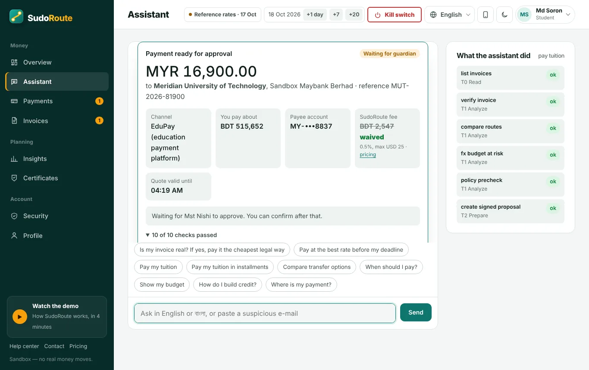
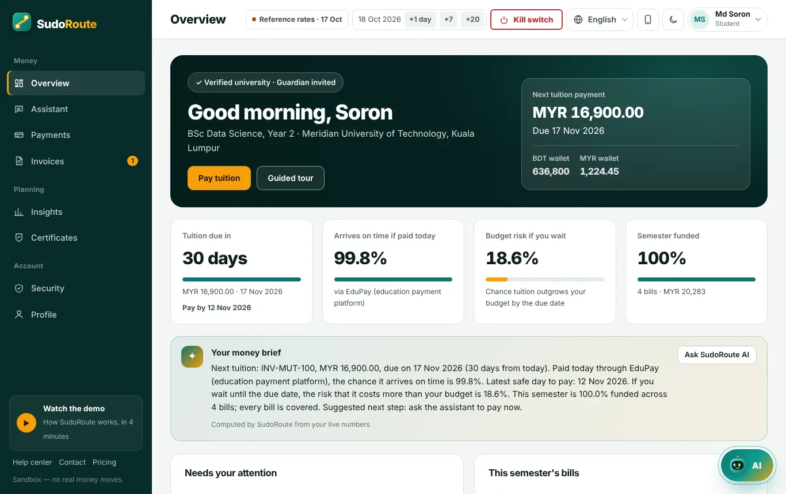
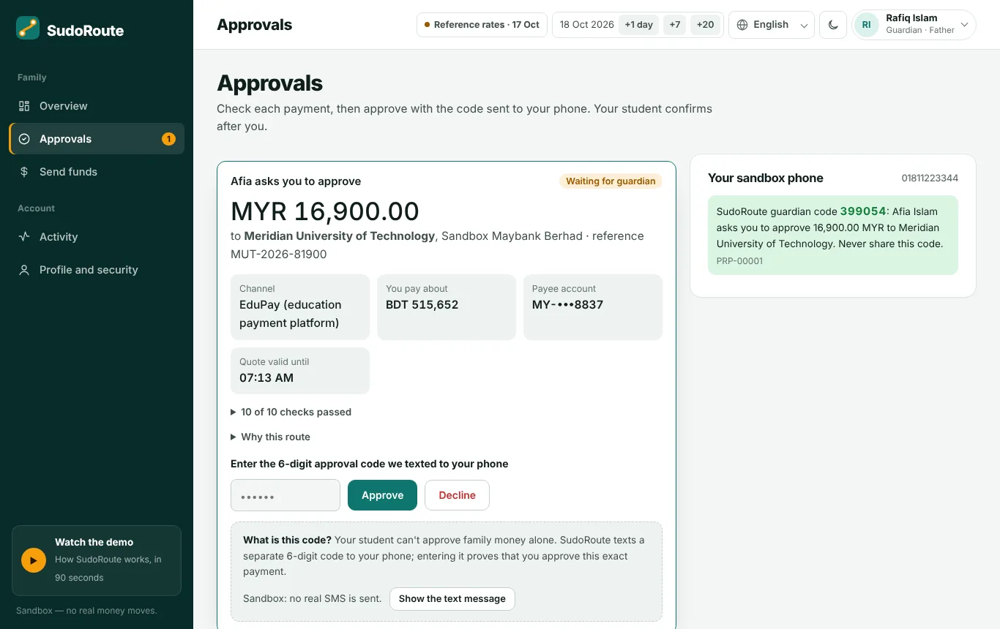

<div align="center">

# SudoRoute

**An AI agent that pays international students' tuition — safely, cheaply and on time.**

[](https://github.com/afiaislam/sudoroute/actions/workflows/tests.yml)


2026 Shenzhen International FinTech Competition · International Track · *AI as a Financial Participant* · **Topic C: Cross-border & Student Finance Assistant**

**[▶ Live demo — sudoroute.onrender.com](https://sudoroute.onrender.com)** &nbsp;·&nbsp; [Technical Document](docs/SudoRoute-Technical-Document.pdf) &nbsp;·&nbsp; [Security Self-Assessment](docs/SudoRoute-Security-Self-Assessment.pdf) &nbsp;·&nbsp; [Pitch Deck](docs/SudoRoute-Pitch-Deck.pdf)



<sub>The agent verified the invoice, compared routes, priced the currency risk and prepared a signed payment — and now waits for the mother's approval. Every tool call is shown with its permission tier.</sub>

</div>

| | |
|---|---|
| **Try it** | [sudoroute.onrender.com](https://sudoroute.onrender.com) → **Try it now — 1 click** (a private sandbox for judges, no sign-up). The free server sleeps when idle; the first load can take ~1 minute. |
| **Watch it** | 4-minute demo video on the home page (`web/static/video/sudoroute-demo.mp4`) |
| **Check it** | [`/security-lab`](https://sudoroute.onrender.com/security-lab) (63/63 live attacks) · [`/accuracy`](https://sudoroute.onrender.com/accuracy) (scam shield and baselines) · [`/verify`](https://sudoroute.onrender.com/verify) (certificates) |
| **Read it** | [`docs/`](docs) — Technical Document, Security Self-Assessment, Pitch Deck · [`evidence/`](evidence) — every report and log |

**Contents:** [Problem](#1-the-problem) · [Solution](#2-the-solution) · [Features](#3-features) · [Security](#4-security-and-compliance) · [Results](#5-results-all-computed-by-code-in-this-repository) · [Run it](#6-run-it) · [Architecture](#7-architecture) · [Limitations](#8-honest-limitations) · [Business](#9-business-model) · [Team](#10-team-and-license)

---

## 1. The problem

Every semester, international students send their family's savings abroad to pay tuition — Bangladesh alone sent **$730.6 million** for study abroad in the first 10 months of FY26, more than three times FY20 ([Dhaka Tribune](https://www.dhakatribune.com/business/416004/brain-drain-outward-student-capital-flows-triple), Bangladesh Bank data). Three things go wrong:

1. **Scams.** Fake tuition invoices from look-alike domains ("our bank details have changed") and fake "agents" offering discounts ([UTS](https://www.uts.edu.au/current-students/managing-your-course/fees-and-payment/payment-information/warning-fraudulent-payment-scams), [Anglia Ruskin](https://www.aru.ac.uk/web-payments/scams-and-fraud)) — now with hidden instructions aimed at AI assistants.
2. **Hidden cost.** Sending money cost **6.49%** on average in Q1 2025 and banks were the costliest channel at **14.55%** ([World Bank](https://remittanceprices.worldbank.org/sites/default/files/rpw_main_report_and_annex_q125_1_0.pdf), $200 transfers). Cheaper channels exist, but some are illegal (hundi/hawala) or not allowed by home-country rules.
3. **Currency risk and deadlines.** The bill in MYR or GBP can grow while a family waits — and paying late can cost the enrolment.

No existing tool checks the invoice, the channel's legality, the true cost and the deadline **together, before** money moves.

## 2. The solution

SudoRoute is an AI agent that **does the whole job**: it checks the invoice, chooses the cheapest *licensed* route that arrives on time, prices the currency risk, prepares a signed payment, gets the student's (and family's) approval, tracks the money until the university has it, and issues a verifiable certificate.

> **AI proposes, code disposes, humans execute.**
> The AI plans and prepares. Code decides what is allowed. Only people approve money — except inside a mandate they signed, with fixed limits.

```mermaid
flowchart LR
  A["Student asks<br/>(EN · বাংলা · 中文 · Malay)"] --> B["Gemini planner<br/>fixed tools, no pay tool"]
  B --> C["Scam shield<br/>invoice vs registry"]
  C --> D["Cheapest licensed route<br/>+ currency risk"]
  D --> E["Policy engine<br/>10 checks"]
  E --> F["Signed proposal<br/>HMAC-SHA256"]
  F --> G["AI auditor<br/>can only hold"]
  G --> H["Guardian approves<br/>own code"]
  H --> I["Student confirms<br/>own code"]
  I --> J["Paid to verified<br/>university account"]
  J --> K["Ed25519 certificate<br/>+ Bitcoin timestamp"]
```



### Judge mode — the whole system in 60 seconds

Press **Try it now — 1 click** on the home page (the only button that signs in by itself; every other "Get started" opens a sign-in / create-account window). You get a **private sandbox** (own bank, FX market and clock) with a student, **Md Soron**, and his mother, **Mst Nishi**. A guide on the right walks you through it, one button per step:

1. **Ask it now** — the agent verifies the invoice, compares routes and prepares a signed payment.
2. **Switch to Nishi** → **Fill Nishi's code** → **Approve** — the mother approves with her own one-time code.
3. **Switch to Soron** → **Fill Soron's code** → **Confirm and pay** — the student's code only appears after the mother approves.
4. **Move the clock +7 days** — the payment arrives at the university.
5. **Open Certificates** — a signed certificate, verifiable online and downloadable as a **PDF**.

Codes arrive on an in-app sandbox phone and are filled in with one click. Judges never see each other's sandbox; sandboxes are deleted after 24 hours.

<table><tr>
<td><br><sub>Student dashboard — due date, on-time chance, budget risk of waiting</sub></td>
<td><br><sub>Guardian portal — the mother approves with her own code</sub></td>
</tr></table>

## 3. Features

| Feature | What it does |
|---|---|
| **AI planner (Gemini)** | Turns a request like *"Is my invoice real? If yes, pay it the cheapest legal way"* into steps, calls tools from a fixed list, reads the results and re-plans. Works in English, বাংলা, 中文 and Malay. The chat shows every tool call and its permission tier. |
| **Independent AI auditor** | A second AI reviews every prepared payment and may only **hold** it with a reason. The student must read the reason before paying. It cannot approve or change anything. |
| **Quarantined AI reader** | Pasted e-mails and invoices are read by a separate AI with **no tools**. It can raise a warning the rules missed, never clear one. |
| **Scam shield** | Scores every invoice 0–100 (look-alike domains, changed bank details, urgency, crypto, hidden AI instructions) and explains every point, in four languages. |
| **Cheapest legal route** | Compares bank wire, education platforms, licensed transfer operators and cards by real landed cost (hidden FX markup + fees + risk of arriving late), excluding channels the home country does not allow. |
| **Currency risk** | EWMA volatility + 4,000-path Monte Carlo: the chance that waiting pushes tuition over the family's budget. |
| **Smart timing** | *"Pay at the best rate before my deadline."* The student approves once; the agent checks the rate every day and pays by itself at the target rate or on the last safe day — never below a signed price floor, only to the verified university. |
| **Instalments** | A 3-part plan the agent runs by itself after one approval (same payee and invoice, pauses if the currency moves more than 5%). |
| **Guardian co-approval** | When family money is used, the guardian approves with their own code before the student confirms. Guardians link by e-mail at sign-up. |
| **Kill switch** | Student or guardian stops everything with one press. Releasing needs the password. |
| **Authenticator app** | Google/Microsoft Authenticator (TOTP, RFC 6238) instead of SMS codes. |
| **Signed certificates** | Ed25519-signed proof of an on-time payment, a payment history or proof of funds. Anyone checks it on `/verify`; one changed character fails. **Download PDF** prints a one-page certificate. |
| **On-chain proof** | A hash of each certificate and the audit log is timestamped on **Bitcoin via OpenTimestamps** (no money or personal data on-chain). Our test record is confirmed in **block 972087**. |
| **Failed-transfer recovery** | A returned or short-paid transfer is reconciled; only the shortfall is offered, never a double payment. |
| **SudoRoute AI on every page** | Students, guardians and visitors can ask questions; every number in an AI answer is checked against the real data. |

## 4. Security and compliance

| Control | How |
|---|---|
| **Permission tiers** | T0 Read · T1 Analyze · T2 Prepare · T3 Execute · T4 Prohibited. The AI's tool list has **no execute tool**. The student chooses *Read only / Advisor / Assisted*; the agent cannot raise its own level. |
| **Signed proposals** | Amount, payee and route are sealed with HMAC-SHA256. Money moves only through confirmation with a one-time code. Any change → rejected. |
| **Verified payees only** | Bank details come only from the university registry — never from an invoice, e-mail or chat. |
| **Policy engine** | 10 checks before **and again at** execution: verified payee, invoice, no overpayment, licensed and country-permitted channel, sanctions, limits, funds, anti-money-laundering pattern, documents. |
| **Prompt-injection defence** | Untrusted text is quarantined and can never create a payment. Detection in English, Malay, Bangla and Chinese. |
| **Tamper-evident audit log** | Every action is SHA-256 hash-chained; edits or deletions are detected. |
| **Accounts and sessions** | PBKDF2 passwords, lockout, CSRF tokens, HttpOnly/SameSite cookies, strict CSP, rate limits, no account enumeration, role isolation. |

Known risks and their limits are listed in section 8.

## 5. Results (all computed by code in this repository)

| Measure | Result | Reproduce |
|---|---|---|
| Automated tests (13 suites) | **230 passed** | `python -m unittest discover -s tests -t .` |
| Security Lab | **63/63** — 57 attacks blocked (incl. a deliberately hostile AI model) + 6 controls that must succeed | `python scripts/security_lab.py` or `/security-lab` |
| Scam shield (84 hold-out invoices, 4 languages) | **100% of scams flagged, 0 genuine invoices blocked** | `python scripts/benchmark_scam_shield.py` |
| vs bank wire (160 priced payments) | **0** scams paid (bank wire: 42 of 42) · **1.82%** cheaper · **0** rule-breaking channels | `python scripts/benchmark_baselines.py` |
| End-to-end demo | **9 scenarios, 41 checked steps**, audit chain valid | `python scripts/run_demo.py` |
| Real Gemini (20 Oct 2026, gemini-3.1-flash-lite) | **23 of 24** requests in 4 languages planned correctly vs 19/24 for rules alone (the miss failed safe) · 15 multi-step plans · AI reader raised scam blocks from 19 to 28 of 42 with 0 genuine blocked · **0** money moved · **0** leaks · reader monotonic **100%** | `python scripts/eval_live_llm.py` (needs a key) → `evidence/live_llm_eval.md` |

Reports are in `evidence/`; screenshots in `evidence/screenshots/`.

## 6. Run it

Requires **Python 3.10+**. No packages to install.

```bash
git clone https://github.com/afiaislam/sudoroute.git
cd sudoroute
python run.py                 # open http://127.0.0.1:8000
```

**Turn on Gemini (optional, recommended).** Every feature also works without it, through the rule engine.

```bash
cp .env.example .env          # Windows: copy .env.example .env
# put your key in .env:  GEMINI_API_KEY=...
python scripts/check_gemini.py
python run.py
```

**Publish (free).** Push to GitHub → on render.com choose **New → Blueprint** → select the repo. Add `GEMINI_API_KEY` in the Render dashboard, never in the repository. Free instances sleep when idle — open the link once before presenting.

| Variable | Purpose |
|---|---|
| `GEMINI_API_KEY` | Enables Gemini |
| `TS_LLM_MODEL` | Preferred model (default `gemini-3.1-flash-lite`, with automatic fallbacks) |
| `TS_SECRET` | Proposal-signing key (generated by Render) |
| `TS_DEMO_MODE=0` | Turns off the sandbox clock tools |

## 7. Architecture

```
Browser (vanilla JS, no build)  ──HTTP──▶  server.py (stdlib HTTP server: validation, sessions, CSRF, rate limits)
                                                │
                                   agent/core.py — the agent
       Gemini planner → permission gate → policy engine → signed proposal → AI auditor (hold only) → human approval
       Quarantined reader (untrusted text, no tools) ──▶ can only add risk
                                                │
   engines/   invoice_check · routes · fx_risk · fx_timing · budget · credit
   security/  permissions · proposals · policy · audit · auth · totp · ed25519 · redteam (Security Lab)
   sandbox/   bank · FX market · university registry          chain/  OpenTimestamps anchoring
```

```
sudoroute/   agent · engines · security · sandbox · chain · benchmark · server.py
web/         pages (home, portals, proof pages, help, pricing, contact, legal) · static/ (CSS, JS, i18n EN/中文/বাংলা)
tests/       230 tests          scripts/   demo, Security Lab, benchmarks, Gemini check, video recorder
evidence/    reports, logs, on-chain proof, screenshots          render.yaml · Dockerfile
```

**Backend.** One Python process (`sudoroute/server.py`) on the standard library only — no framework, database server or third-party packages. It serves the pages and 62 JSON API paths, owns all state, and is the only place money logic runs; the browser only displays results. Requests are JSON-only and size-limited (64 KB), rate-limited per IP, checked for session, CSRF token and origin, and answered with strict security headers. State is kept in JSON files in `data/`, written atomically under locks; the audit log is an append-only hash chain. Judges each get a private sandbox world (own bank, FX market, clock and agent). Details: section 5 of the Technical Document.

## 8. Honest limitations

- **Sandbox only.** Universities, banks, accounts and channels are simulated; no real money moves. Exchange-rate levels are real (live feed or a dated snapshot); their future movement is simulated. In production, licensed partners would execute payments.
- **Synthetic test data.** Both scam-shield sets were written by the team. On the second set, 2 of 12 genuine invoices still go to review (a check with the university, never a lost payment).
- **AI variability.** Tests use a simulated (and a deliberately hostile) model so they run offline; `scripts/eval_live_llm.py` measures the real Gemini model. Safety does not depend on the model — it is enforced by code.
- **Smart timing** lowers cost on average, not on every path; the worst case is bounded by the signed floor and shown before approval.
- **Country rules** (BD, NG, IN, PK) are simplified and must be validated with regulators and banks.
- **SMS** is simulated by the in-app phone (optional Twilio support); the authenticator app works for real.
- **Certificates** are not yet recognised by credit bureaus. New on-chain anchors need internet and a few hours to confirm.
- Accounts made with *Create account* share one sandbox clock per server; judges should use *Try it now*.

## 9. Business model

One visible service fee — **0.5% (min USD 3, max USD 25)**, waived in the pilot — and never a hidden exchange-rate markup. Free for universities. Details on `/pricing`.

## 10. Team and license

Team SudoRoute:

- **Afia Islam** — Team Leader · Varendra University, Rajshahi, Bangladesh
- **Md. Shamsul Alam Soron** — Team Member · Lincoln University College, Malaysia

Contact: afiaislam2313@gmail.com · WhatsApp +880 1906-032900.

Documents: [Technical Document](docs/SudoRoute-Technical-Document.pdf) · [Security Self-Assessment](docs/SudoRoute-Security-Self-Assessment.pdf) · [Pitch Deck](docs/SudoRoute-Pitch-Deck.pdf).

MIT license (`LICENSE`). Included third-party file: `web/static/qrcode.js` (MIT, see `THIRD_PARTY_NOTICES.md`). Photos from [Unsplash](https://unsplash.com) under the Unsplash License.
